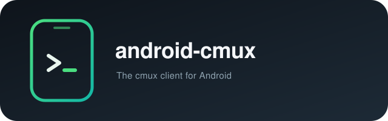

  

  
  
  
  

  [简体中文](README_cn.md)

# android-cmux

> The cmux client for Android: watch your terminal and your coding agents from a phone, and step in when they need you.

This is the Android counterpart of [cmux](https://github.com/xhqing/cmux) — a Ghostty-based macOS terminal with vertical tabs built for multitasking with coding agents. Upstream ships an iOS beta whose source is not public; Android has nothing. This project fills that gap by talking to the protocol the Mac side already speaks.

## Status

**Early skeleton.** The repository, build setup and protocol documentation are in place; no working client yet. The roadmap is in `TODO.md` and `DEVELOPMENT.md`.

## Why a separate project

- **The Mac side already has the hard part.** Iroh/QUIC transport, 107 `mobile.*` RPC methods, cell-level `render-grid` snapshots, pairing and account authorization are all implemented in cmux.
- **The client is a different stack.** Kotlin + Jetpack Compose, built with Gradle, shipped through Android channels — nothing shared with the Swift codebase except the wire protocol.
- **Deliberately decoupled.** cmux is GPL-3.0-or-later; this project does not copy its code. It implements the protocol independently, which keeps the licence here MIT.

## How it connects

| Layer | What the Mac provides | What this project does |
| --- | --- | --- |
| Transport | Iroh (QUIC + NAT traversal) via `iroh-ffi` | Uses the same Kotlin binding |
| Streams | Binary lane header, 6 lanes | Re-implements the header byte-for-byte |
| Messages | JSON (Swift `Codable`), 107 `mobile.*` methods | Kotlin data classes matching the field names |
| Terminal | `render-grid` (`cmux.render-grid.v1`) cell snapshots + deltas | Draws cells on a Compose canvas |
| Auth | Stack Auth account + device signature + attach ticket | Own REST client + Android Keystore |

Details, including the lane list and the field-naming rules, are in `DEVELOPMENT.md`.

## Requirements

- A Mac running [cmux](https://github.com/xhqing/cmux) with the Mobile host enabled
- Android 10 (API 29) or newer — `iroh-ffi` requires it
- JDK 17 and Android SDK for local builds (CI has both)

## Contributing

See `CONTRIBUTING.md`. You keep the copyright in what you send; the contribution is licensed to this project under MIT.

## Licence

MIT — see `LICENSE.md`. Copyright (c) 2026 xhqing and contributors.
